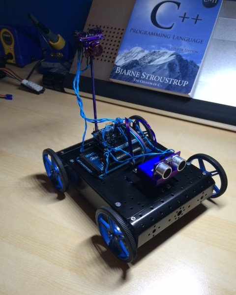
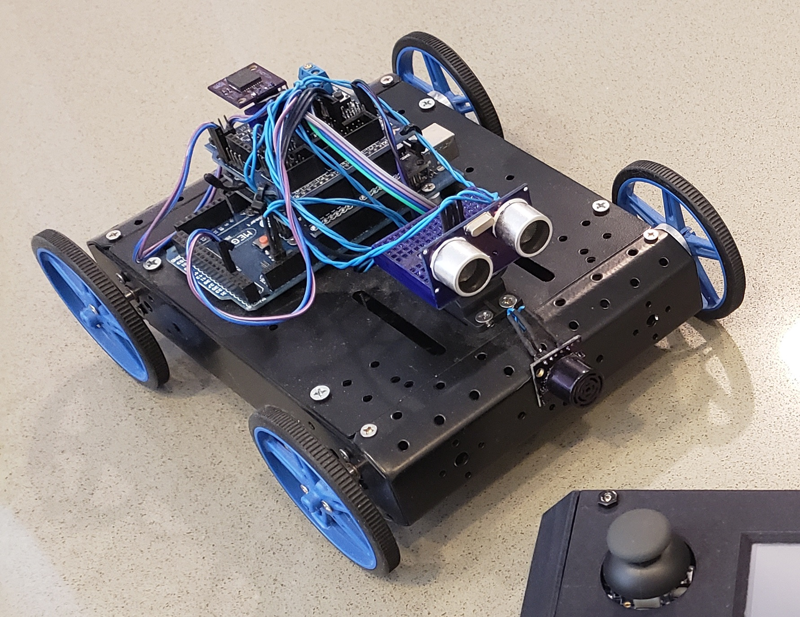
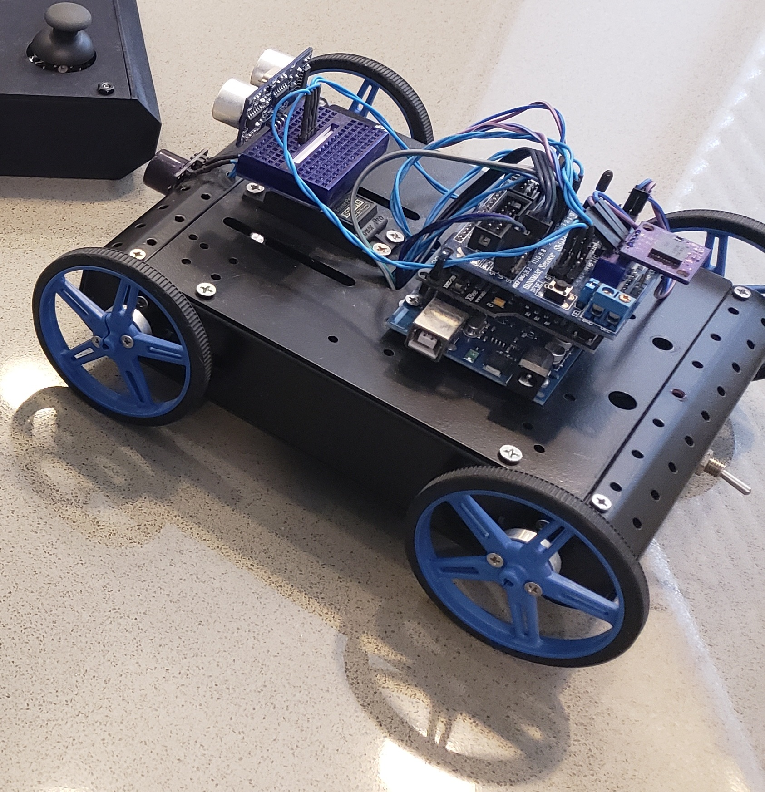

# Floorplan Rover

## Overview

This is an autonomous rover that tries to create an accurate floorplan, assuming that the floor is free of furniture/objects.  "Tries" is the operative word, as challenges relating to orientation were encountered, but it was a fun exercise in sensor fusion, wireless telemetry and real-time visualization.

The rover's firmware (C++, Arduino) combines several sensors:

- **Ultrasonic ping sensors** detect obstacles and measure the distance to walls.  A safety check stops the motors whenever an object is too close.
- **Quadrature wheel encoders** measure the distance traveled.
- **A magnetometer** tracks heading in world space.  I applied hard-iron and soft-iron calibration offsets to correct for magnetic interference, though the motors and building wiring still limited its accuracy.  Turns are closed-loop: the rover keeps rotating until the compass reports the target heading, within a tolerance.

The rover streams its position, heading and wall measurements over a **ZigBee** wireless link to a base station PC.  There, a desktop application builds the floorplan as the data arrives.

## Base Station Application

The desktop application is a C# WinForms app with an embedded XNA 3D rendering surface.  It draws a world-space grid, the rover's live position/orientation, the path it traveled, and wall "markers" from the distance readings.  Markers that fall within a configurable radius of each other are automatically joined into wall segments, so the floorplan takes shape as the rover approaches and detects walls.  The app also includes a serial port selector and a command panel for driving the rover manually.

Telemetry uses a custom binary framing protocol built from SYN/STX/ETX/EOT control bytes and XOR checksum. The desktop side parses it with a state machine that recovers cleanly from corrupted/partial packets on the noisy radio link.  

## Photos

