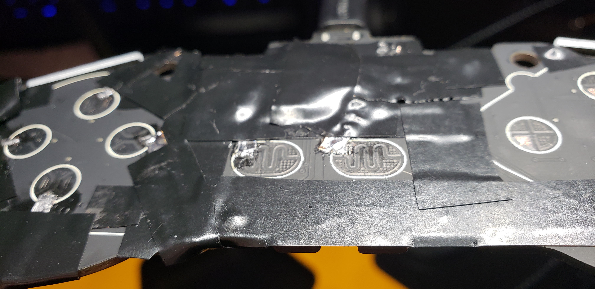
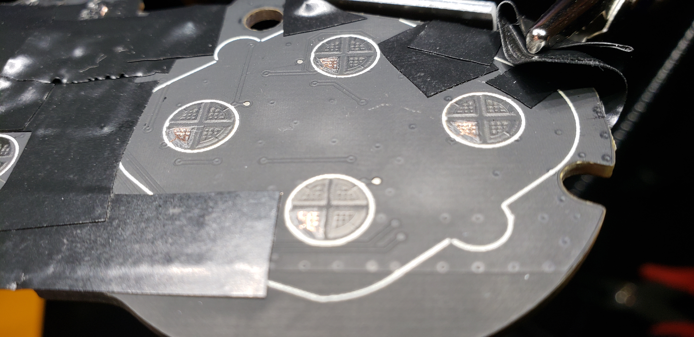
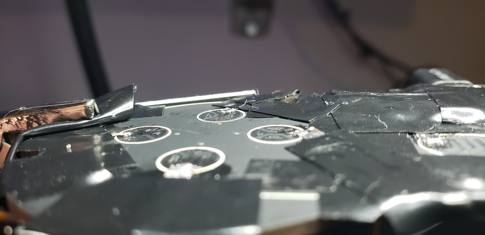
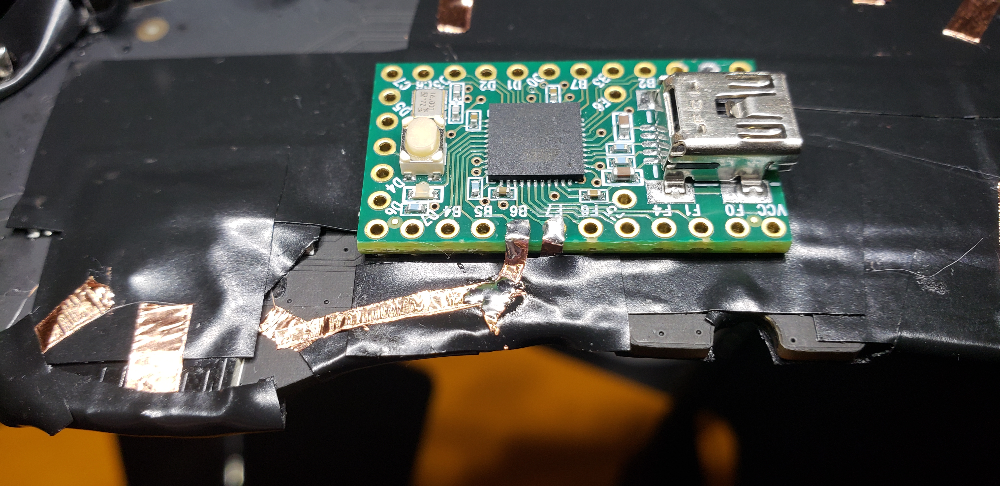
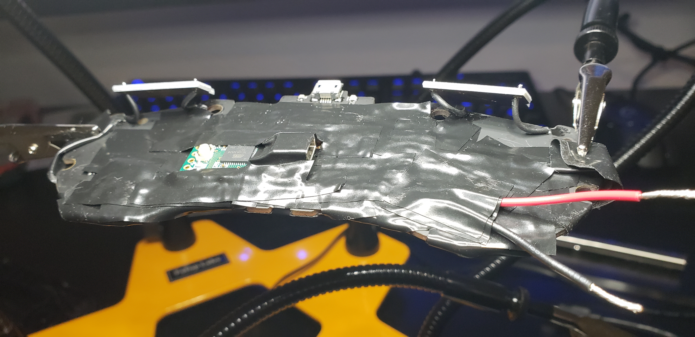
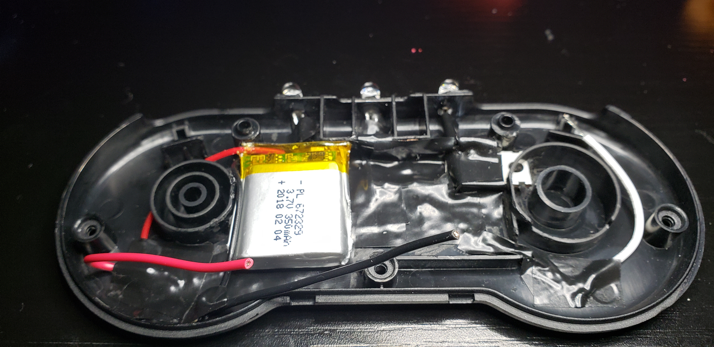
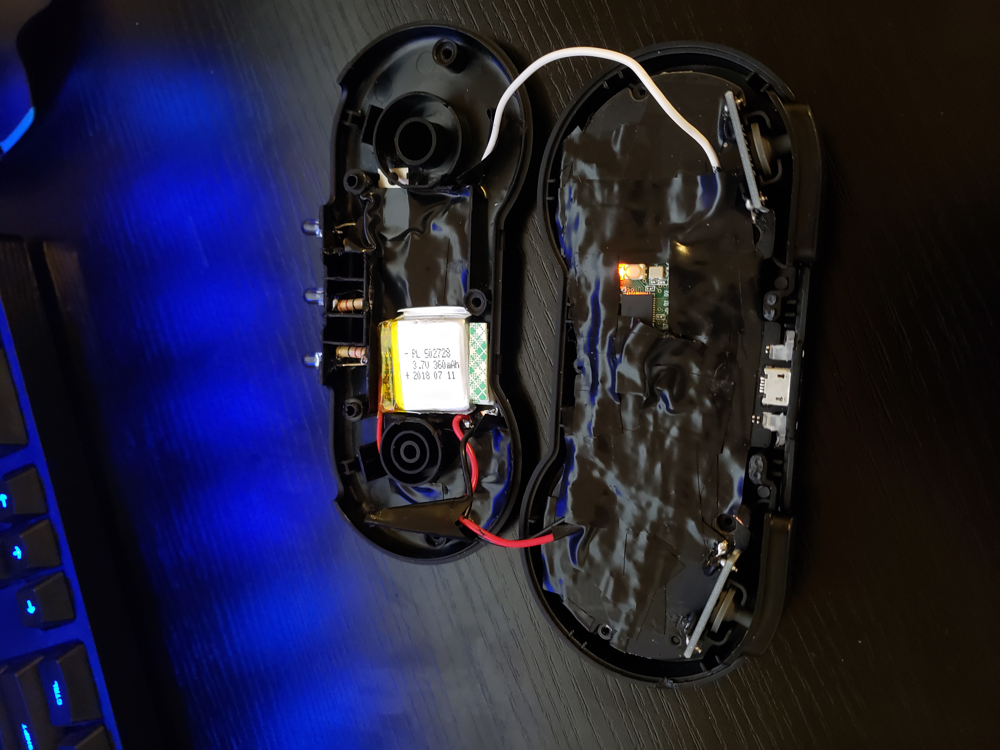

# Gamepad IR Remote

## Overview

This is a SNES-style gamepad that was used to control a home theater.  A small Arduino-compatible board, an IR LED and a battery was fitted inside the original controller housing.  There was so little room that even 22/24-gauge wire would have kept the housing from closing, so conductive tape was used for most of the internal wiring.

## Technical Highlights

- **Two control modes:** a short press of Select switches the gamepad between controlling the audio receiver and projector.  A long press switches the receiver's input between the game console and the media player.  Pressing both shoulder buttons together opens the current device's menu.
- **Multiple IR protocols:** the projector uses the JVC protocol, some receiver functions use RC5x, and the rest are raw timing sequences that was captured from the original remotes using a custom IR receiver/decoder setup.
- **Compact signal storage:** I stored the raw IR timings as single bytes in units of 10 µs, with one reserved value standing in for the long gap.  This takes half the memory of 16-bit timings, which matters on a small microcontroller.
- **Battery-conscious firmware:** at startup the firmware halves the CPU clock and turns off the ADC and serial port.  Between input polls, the MCU drops into idle sleep.
- **Debounce and repeat handling:** the firmware counts how many polls each button has been held.  It uses those counts to tell short presses from long presses and to limit how fast held buttons repeat their IR commands.

## Photos

