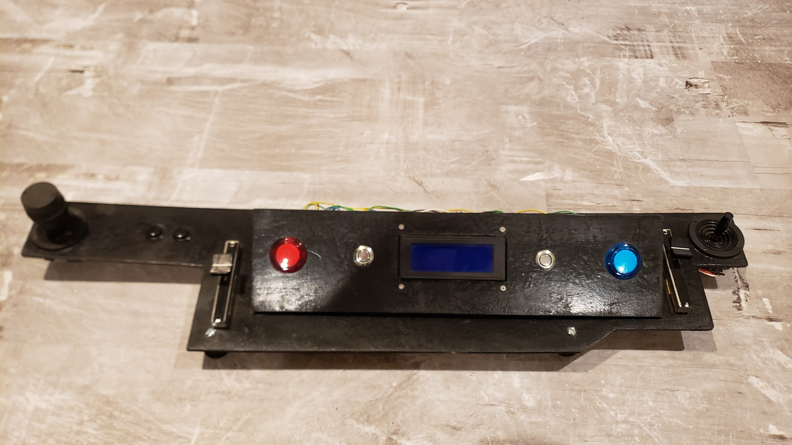
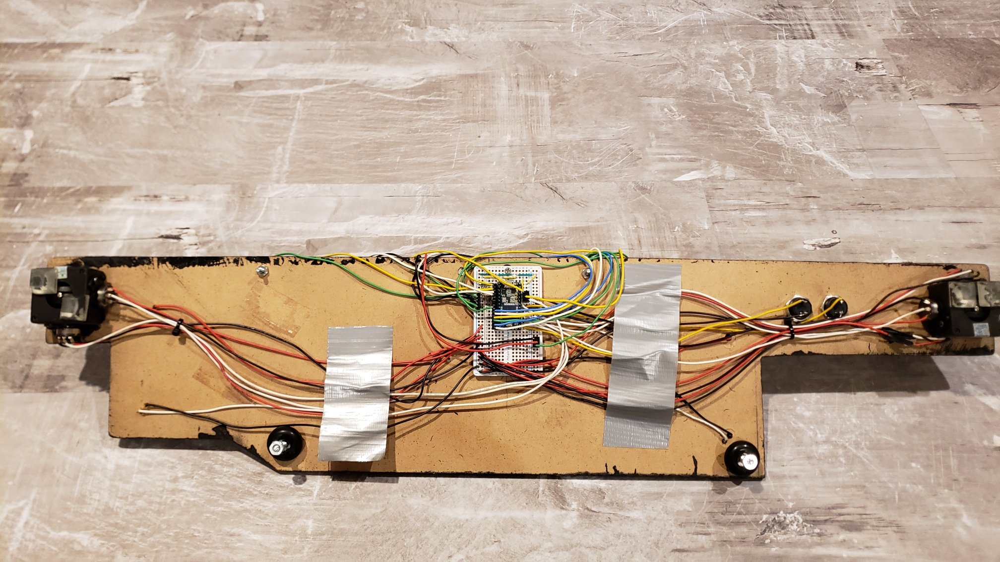
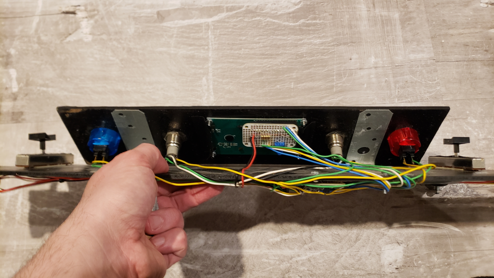

# Kerbal Space Program Joystick

## Overview

This is a custom joystick for Kerbal Space Program.  It won't be winning any beauty contests, but it works like a champ, is shaped to conform to my keyboard (along the near/south edge), and is easy to put away!  

The controller has two parts:

- **Joystick hardware (C++):** two analog sticks, two throttle sliders, and buttons for staging, camera view, RCS, SAS and docking/grabbing.  The microcontroller presents itself to the PC as a native **USB HID joystick**, so the game sees a standard game controller and needs no special drivers.
- **Game mod (C#):** a plugin that runs inside the game. It reads live flight data and streams it to a 20x4 character LCD on the controller.

## Technical Highlights

- **Live telemetry display:** the mod reports fuel, monopropellant and electric charge as percentages, plus speed and altitude.  Above 35 km, the speed switches automatically from surface velocity to orbital velocity.  The LCD draws the resources as smooth bar graphs, using custom glyphs to show half-cell resolution.
- **Efficient rendering:** the firmware keeps a cache of what's already on the LCD and redraws only the cells that changed, which keeps updates fast on a slow display.
- **Cooperative multitasking:** the firmware uses protothreads to run input polling and serial message processing concurrently, with a hardware timer interrupt setting the timing.
- **Native interop:** the mod talks to the controller through a small native C++ serial library, which it calls from the game's .NET/Mono runtime through P/Invoke.
- **Low overhead in game:** the mod rebuilds its list of resource tanks only when the vessel's stage or part count changes, and it throttles its updates, so it doesn't negatively affect frame rate.

## Photos

