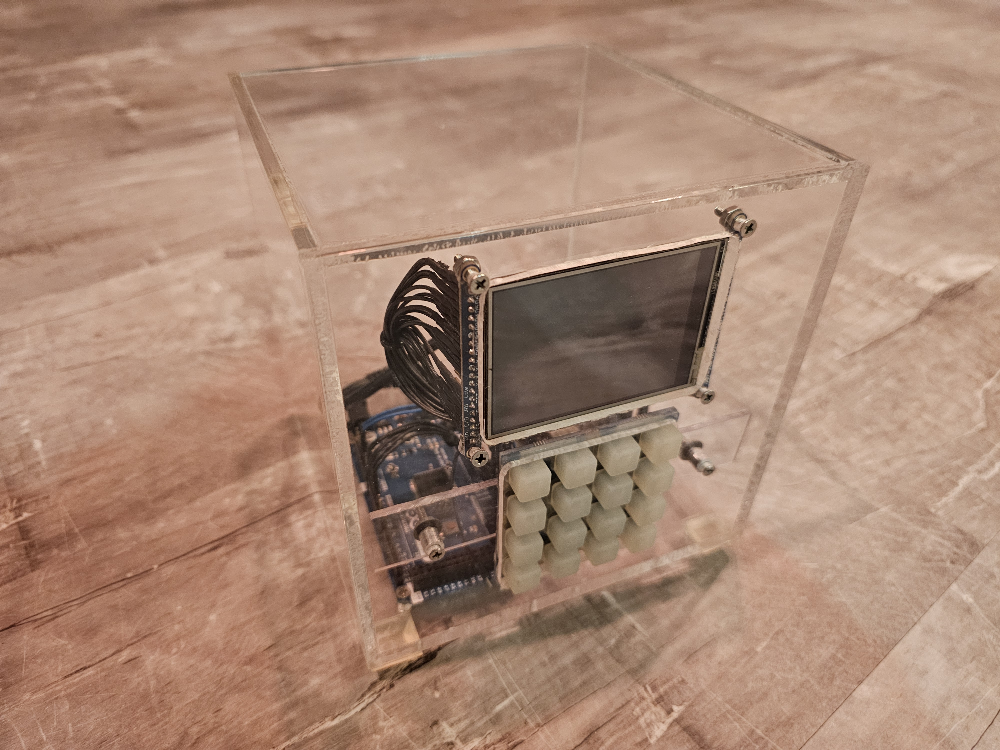
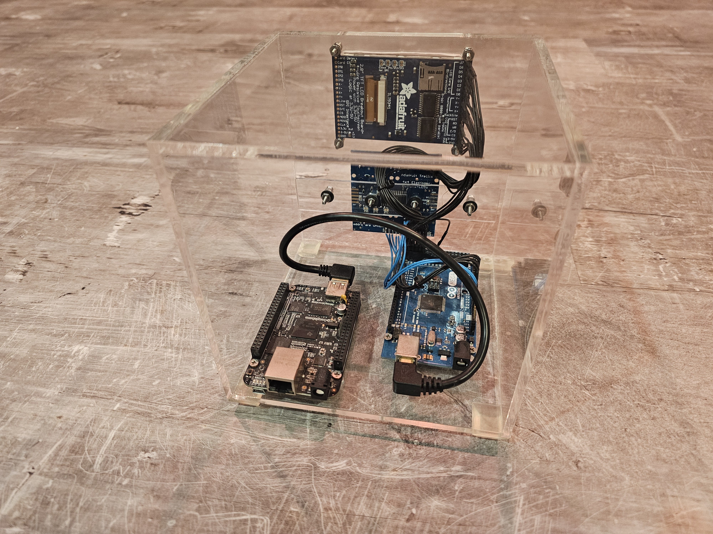
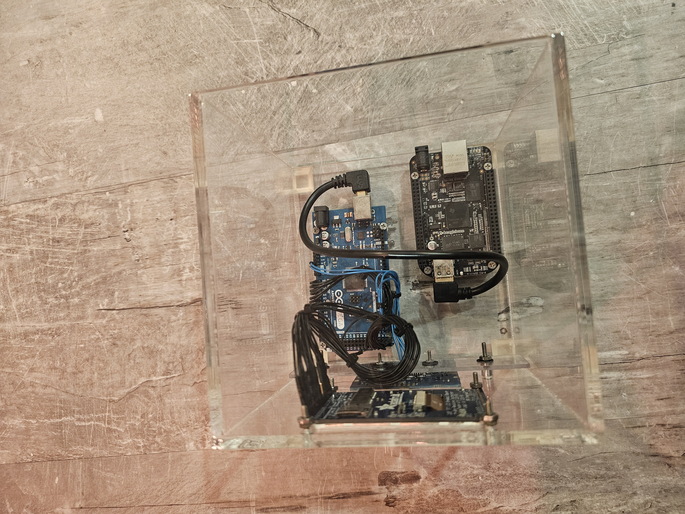

# Physical Digital File Safe

## Overview

A network-connected, physical "safe" for storing digital files.  Made using a clear acrylic cube that holds a BeagleBone Black, an Arduino Mega, 4x4 LED-lit button pad and a 2.8" touchscreen.  You manage it from a browser over the network using a web interface that lets you upload and manage files that are stored (encrypted) on the BeagleBone.

The system has two halves that communicate over a serial link:

- **BeagleBone Black (Linux, Python):** an HTTPS web server built on Tornado.  It handles login, session tokens and file uploads/listings.  Files are encrypted with AES-256 using libtomcrypt (C++).
- **Arduino Mega (C++):** drives the touchscreen and button pad using "Bones", a small UI framework I wrote for this project.  It provides screens, buttons, a number-pad controller and a packet-based serial controller, all wired together with my [C#-style event system](../C%23%20Event%20System%20in%20C++).

## Security Design

- **Split encryption key:** the 32-byte AES-256 key comes from two sources.  Up to 16 bytes are entered on the safe's physical button pad.  The other 16 bytes are derived from the BeagleBone's MAC address, binding the key to that device.
- **Physical-presence authentication:** to log in through the web interface, you need your password and a one-time code that the safe generates and shows only on its own screen.  Knowing the password alone isn't enough without physical access to the device.
- **Defensive web layer:** the server only accepts HTTPS.  Passwords are stored as SHA-256 hashes.  API calls require a server-issued session token, and the safe records the last login time and number of failed login attempts.
- **Framed serial protocol:** the Linux and microcontroller sides exchange start- and end-delimited, length-prefixed command packets.  These handle actions such as showing the auth code, switching screens and reporting the device's IP address.

## Photos

