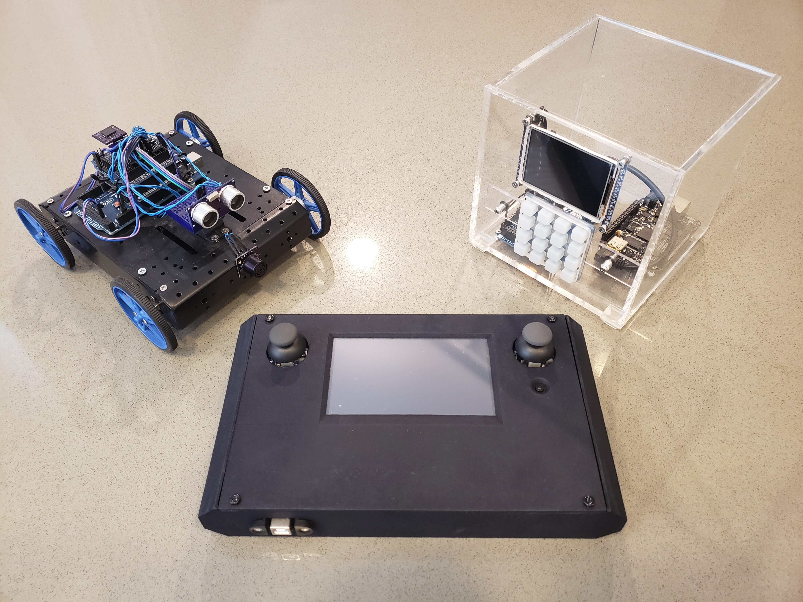

# Embedded Systems & IoT Projects

This is a collection of embedded systems and IoT projects I pursued for fun, dating from 2014 to 2018.  

## Projects

| Project | Summary |
| --- | --- |
| [Touchscreen Remote](Touchscreen%20Remote) | 3D-printed home theater remote with a touchscreen UI framework, thumbsticks and multi-protocol IR output. |
| [Thermostat](Thermostat) | 3D-printed Wi-Fi touchscreen thermostat with protothread-based firmware, a TCP control protocol and an Android companion app. |
| [Physical Digital File Safe](Physical%20Digital%20File%20Safe) | BeagleBone/Arduino-based physical "safe" for storing digital files, with an HTTPS web interface, AES-256 encrypted file storage and physical-presence authentication. |
| [Floorplan Rover](Floorplan%20Rover) | Autonomous mapping rover that streams sensor telemetry over ZigBee to a C#/XNA desktop app, which renders the floorplan live. |
| [Kerbal Space Program Joystick](Kerbal%20Space%20Program%20Joystick) | Custom USB HID joystick plus a C# game mod that streams flight data to an onboard LCD. |
| [Gamepad IR Remote](Gamepad%20IR%20Remote) | SNES-style gamepad turned into a low-power, multi-device IR remote. |
| [WiFi to IR Transmitter](WiFi%20to%20IR%20Transmitter) | Android app and Wi-Fi-to-IR bridge devices for controlling a projector, receiver and Roku from a phone. |
| [Bitmap Converter](Bitmap%20Converter) | C# tool that compresses images into flash-resident, run-length-encoded C++ for microcontroller displays. |
| [C# Event System in C++](C%23%20Event%20System%20in%20C++) | STL-free, C++03 header-only library that brings .NET-style events to embedded code. |

 
