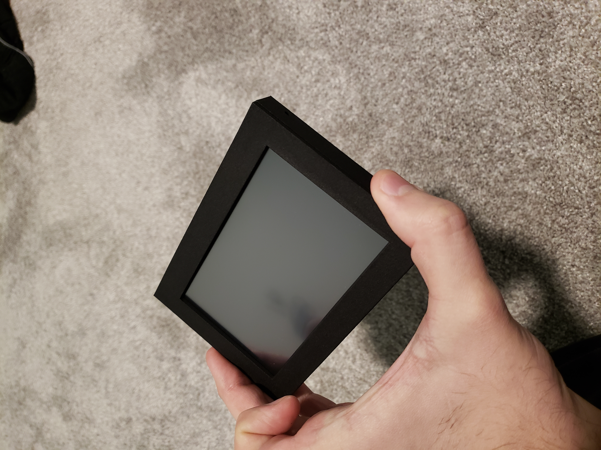
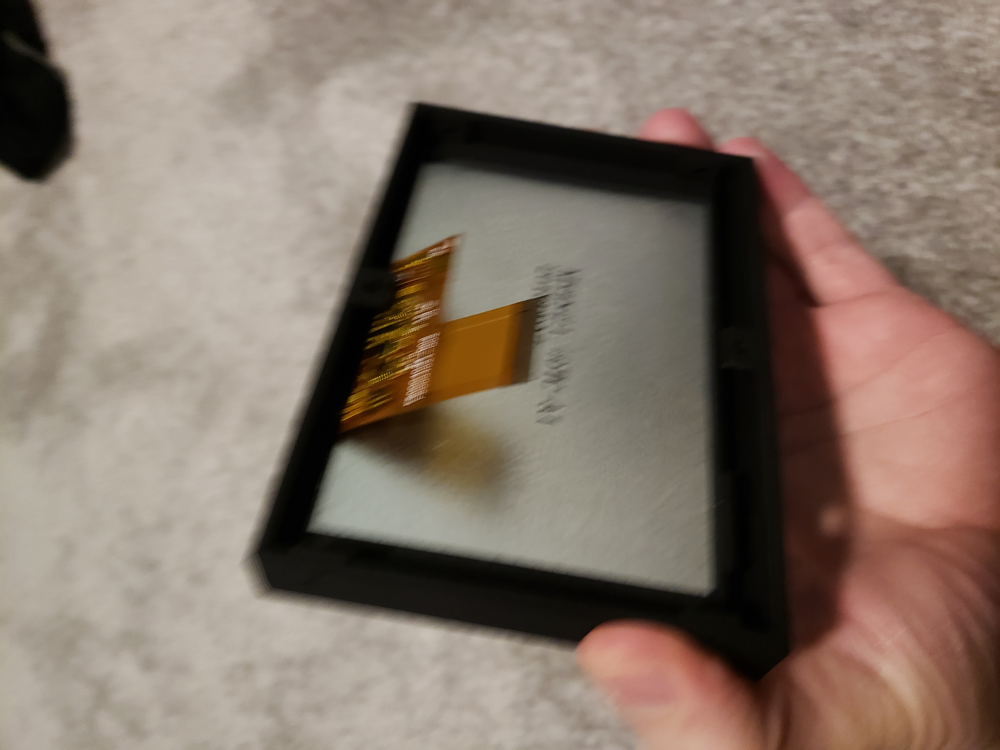
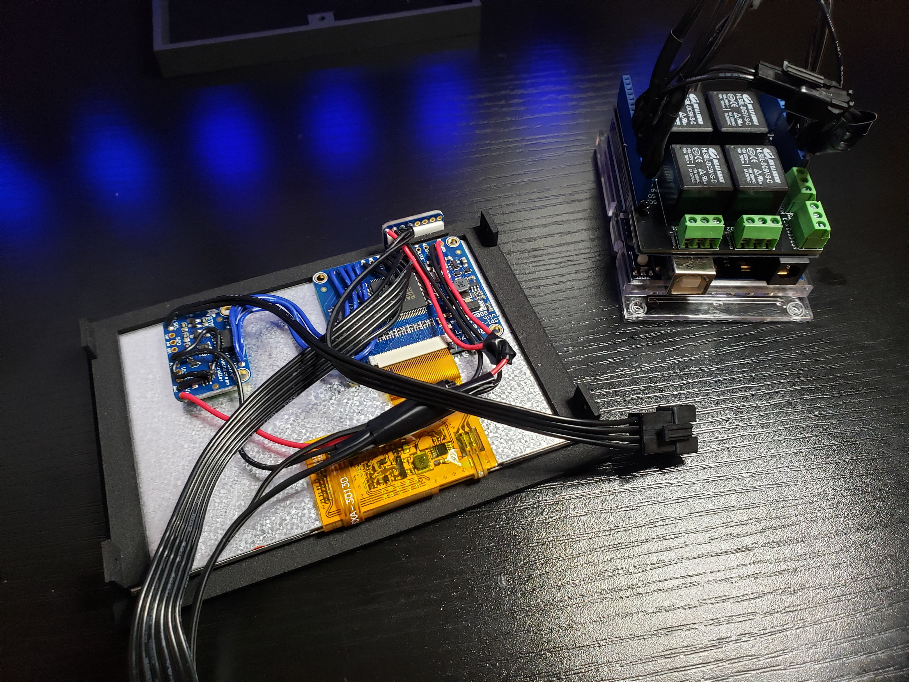
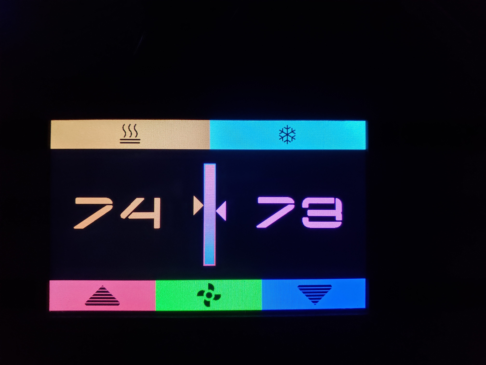
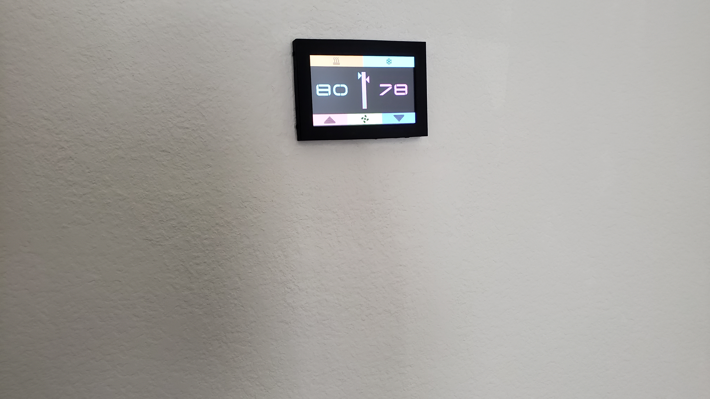
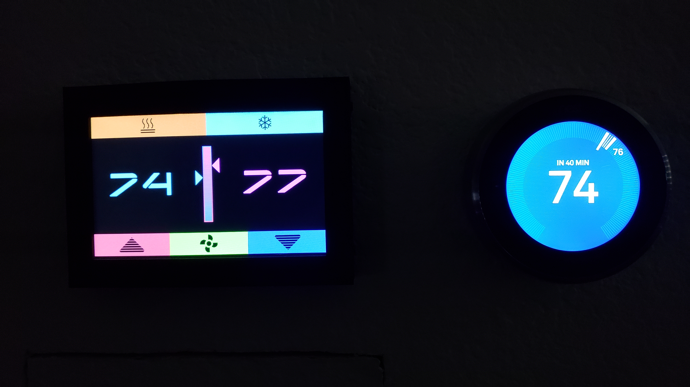
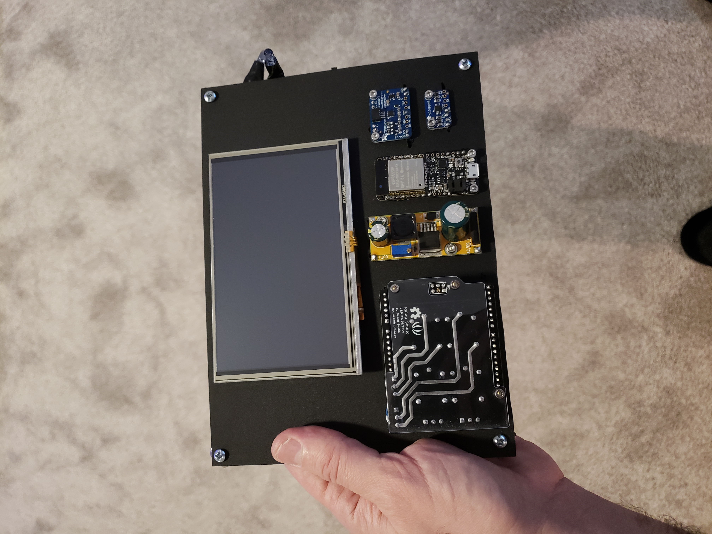
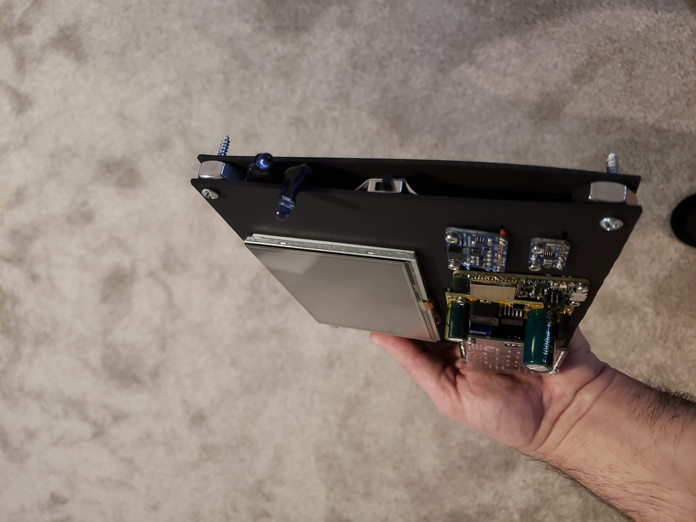
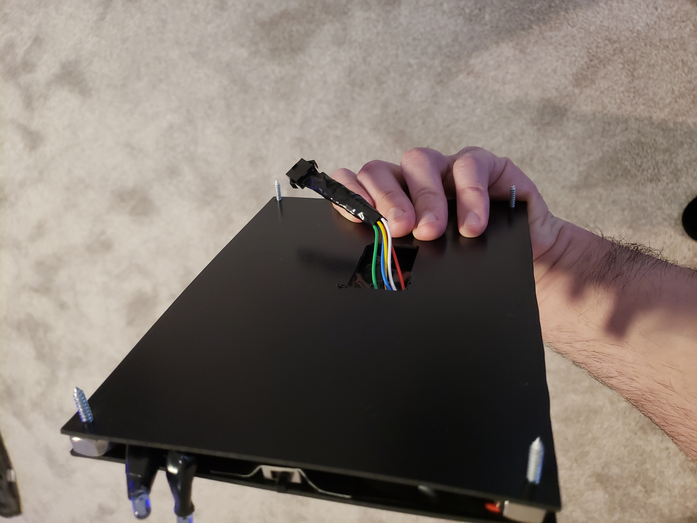
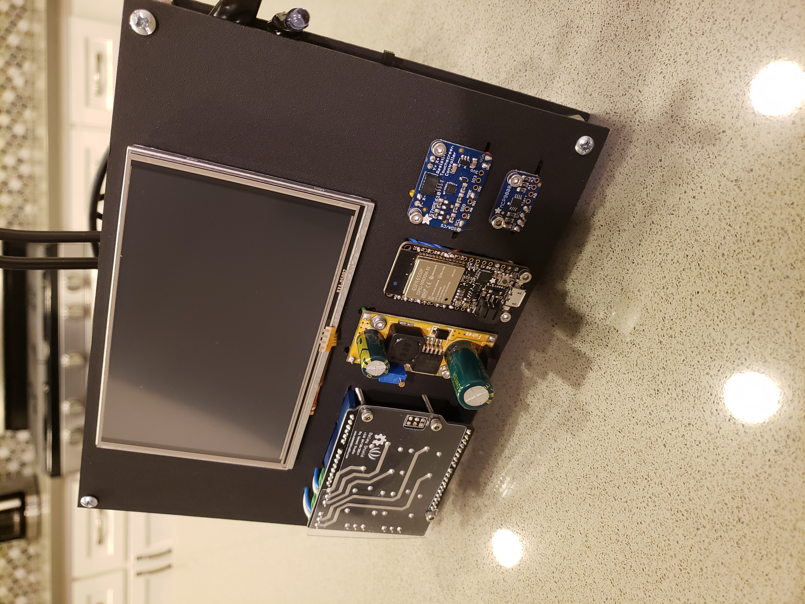

# Touchscreen Thermostat

## Overview

My second 3D-printed project: a custom Wi-Fi touchscreen thermostat that controls the HVAC system through a relay board.  You can operate it from its 800x480 touchscreen or remotely via an Android app.  The enclosure was modeled using 3ds Max and printed using [Shapeways](https://www.shapeways.com).  The photos show the finished product followed by the earlier prototype.

## Technical Highlights

- **Hardware:** a Wi-Fi-enabled Arduino, an RA8875-driven 800x480 TFT with a resistive touch controller, a high-accuracy MCP9808 I2C temperature sensor, and relays that switch on/off heat, AC and the fan.
- **Concurrent firmware design:** four protothreads (touch input, temperature sampling, UI refresh and HVAC control) run cooperatively on a single-core MCU without an RTOS.
- **Custom graphics pipeline:** every icon, label and large digit is a bitmap compressed with my [Bitmap Converter](../Bitmap%20Converter) and stored in flash.  This gives the UI a polished, app-like look on hardware with only kilobytes of RAM.
- **Event-driven UI:** touch buttons and a swipe-to-unlock lock screen raise events through my [C#-style event system](../C%23%20Event%20System%20in%20C++).  This keeps the input handling separate from the thermostat logic.
- **Remote control protocol:** the thermostat runs a small TCP server that accepts framed command packets: change mode, raise/lower the set temperature, toggle the fan, lock/unlock the screen, and query the current state.  Each reply is the thermostat's full state packed into a 32-bit word.  Connections are accepted only from an allow-list of client addresses.  

## Photos

