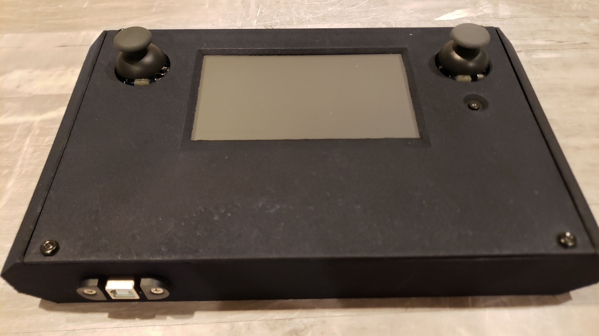
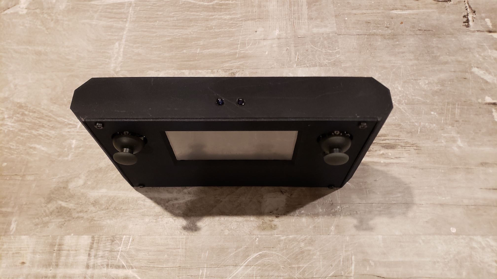
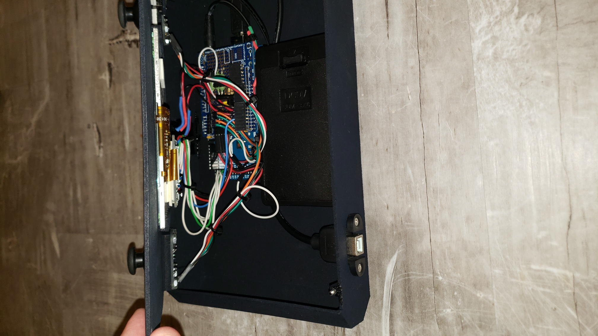
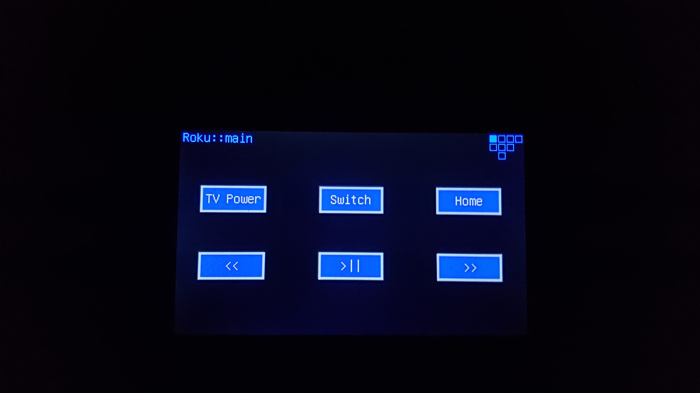
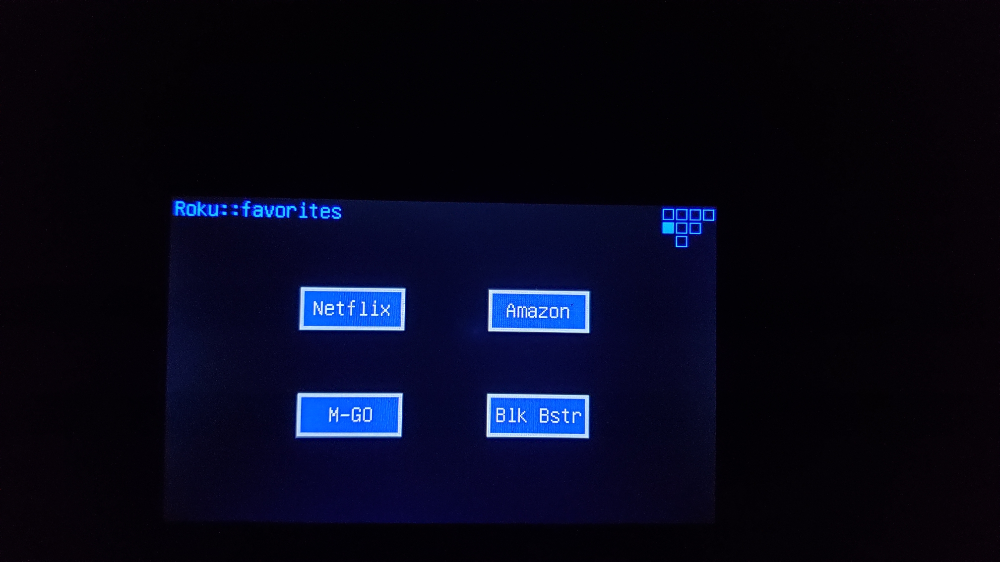
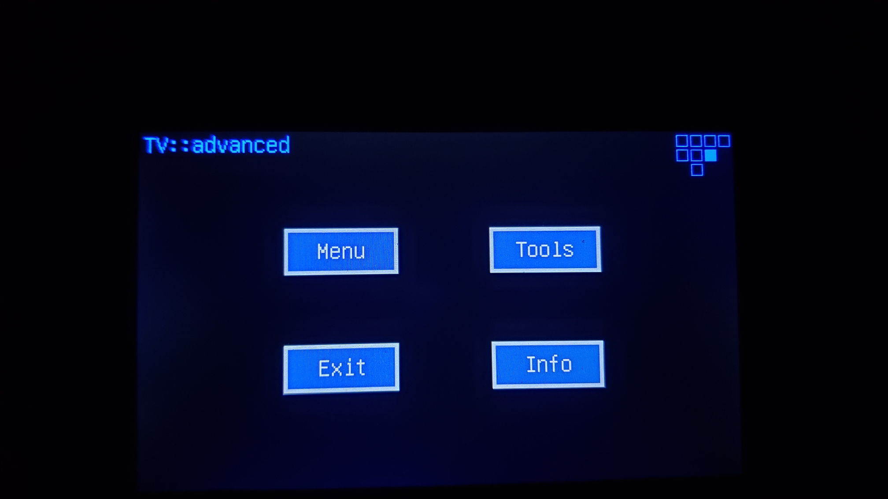
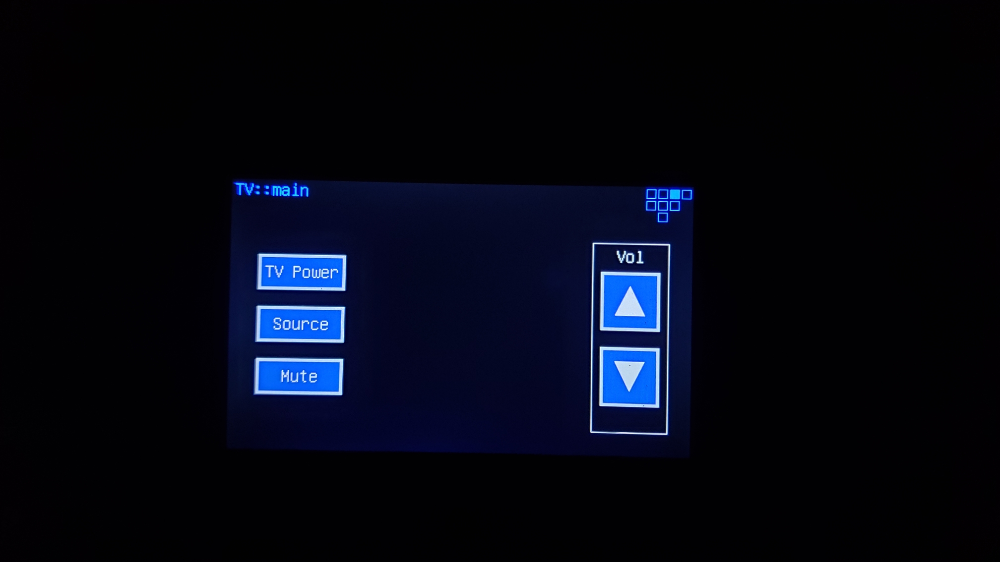
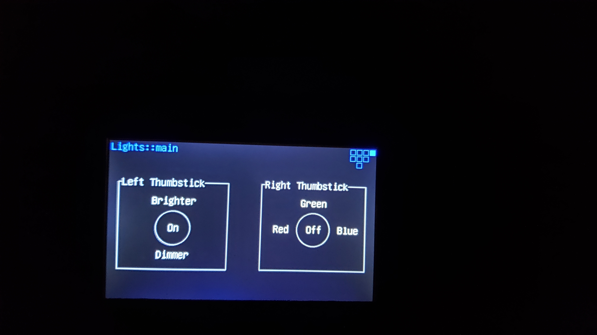

# Touchscreen Remote

## Overview

My first 3D-printed project: a home theater remote with a touchscreen and two thumbsticks.  It controlled the TV, cable box, Roku, HDMI switch and room lighting in my living room.  I modeled the 2 mm-thick enclosure using 3ds Max and had it printed using [Shapeways](https://www.shapeways.com).  

## Technical Highlights

- **Custom UI framework:** I wrote a small reusable library for building touch interfaces on Arduino-class hardware.  It manages multiple screens, rectangular and triangular buttons, and analog or digital thumbstick input.  Components communicate through my [C#-style event system](../C%23%20Event%20System%20in%20C++), so new screens and controls are easy to compose.
- **Calibrated touch input:** a calibration matrix maps the resistive touch panel's raw readings onto the coordinates of the RA8875-driven TFT.  The firmware checks the touch controller’s interrupt pin and only reads the panel when it’s touched.
- **Multi-protocol IR:** each device gets the right signal format, including NEC, Samsung and raw timing sequences.  The raw codes were captured using a custom IR receiver/decoder setup, which records signals from the original remotes.
- **Analog IR drive circuit:** the IR LEDs run from a constant-current driver, which gives them maximum brightness for good range and a wide field of view.

## Photos

