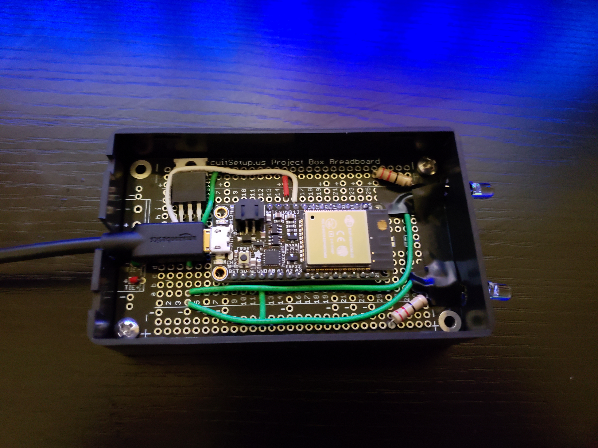
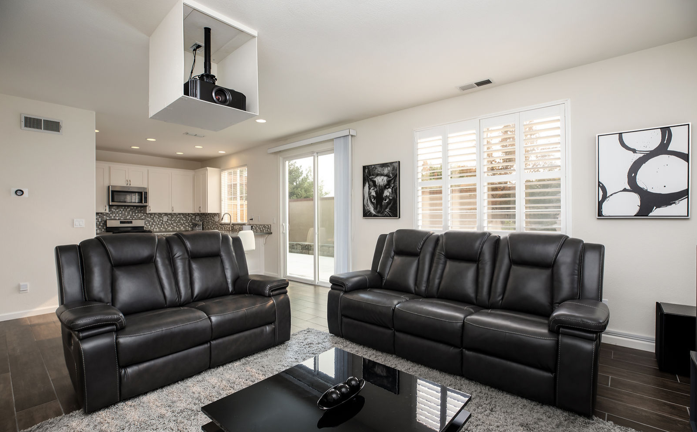

# WiFi to IR Transmitter

## Overview

An Android app paired with WiFi-to-IR bridge devices that let my phone control the home theater in a previous home. One bridge sat on top of the projector, controlled it and the audio receiver.  A second bridge sat inside the projector cabinet/box, aimed directly at a Roku.  The Roku supports WiFi remote control, but only for its own proprietary remote so IR was the only option.

## Technical Highlights

- **Lightweight network protocol:** each bridge has a static IP address and listens for UDP datagrams.  Commands are framed with SYNC and ETB control bytes, so a single short packet triggers an IR command with little latency.  That makes the phone feel as responsive as a physical remote.
- **Protocol translation:** each bridge maps abstract commands such as "volume up", "menu" or "input: game console" onto the signal each device expects.  The projector uses JVC, the Roku uses NEC, and the receiver uses a mix of RC5x and raw timing sequences captured from the original remotes.
- **Multi-device orchestration:** the app sends each command to the right bridge, so one screen on the phone controls three devices from different manufacturers. 

## Photos

